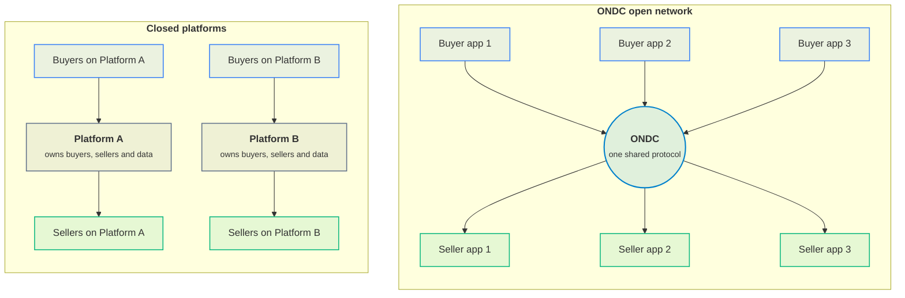

# What ONDC Is

> A short introduction to the Open Network for Digital Commerce for developers who are new to ONDC.

---

Traditional e-commerce platforms are **closed**. A seller on Platform A is only visible to buyers on Platform A; to reach buyers elsewhere, it must integrate with every other platform separately.

**ONDC (Open Network for Digital Commerce)** is an open, decentralized network backed by the Government of India's Department for Promotion of Industry and Internal Trade (DPIIT). It separates **buyer applications** from **seller applications**, so any buyer app can discover and transact with any seller app on the network. No single entity owns the transaction, the data, or the relationship.

Think of it as **UPI for e-commerce**: just as UPI lets any bank's app pay any other bank's app, ONDC lets any buyer app buy from any seller app. Like email, where Gmail and Outlook users can write to each other because both speak SMTP, every participant speaks one shared protocol, based on [Beckn](/developer-guide/docs/protocol).

On a closed platform, a seller reaches only that platform's buyers. On ONDC, every buyer app can reach every seller app.

---

## Developer Resources

| Resource | URL |
| --- | --- |
| **ONDC GitHub (Official)** | [github.com/ONDC-Official](https://github.com/ONDC-Official) |
| **Protocol Specs** | [github.com/ONDC-Official/automation-specifications](https://github.com/ONDC-Official/automation-specifications) |
| **Network Extension Layer** | [github.com/ONDC-Official/protocol-network-extension](https://github.com/ONDC-Official/protocol-network-extension) |
| **Signing & Verification** | [developer-docs/registry/signing-verification.md](https://github.com/ONDC-Official/developer-docs/blob/main/registry/signing-verification.md) |
| **ONDC Portal** | [portal.ondc.org](https://portal.ondc.org) |
