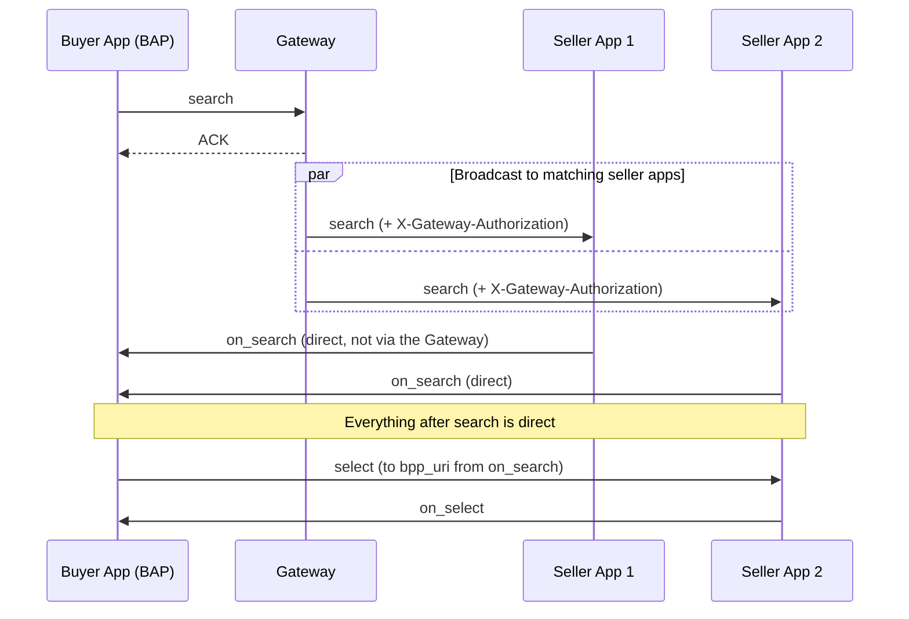
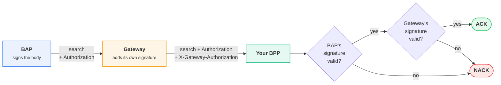

# Gateway

The Beckn Gateway (BG) is a **search multicast router**. Its single job is to take a `search` request from a BAP and fan it out to all BPPs that are relevant to that search's context (domain, city, and so on). Like the Registry, ONDC operates it — you only ever call it or receive from it.

---

## Why the Gateway Exists

Without the Gateway, a BAP sending a search would need to:

1. Know every BPP on the network.
2. Maintain an up-to-date list of which BPPs serve which domains and cities.
3. Send the search to each one individually.

The Gateway removes that burden. The BAP sends **one** `search` to the Gateway, and the Gateway handles the fan-out.

---

## The /search Multicast

The Gateway is involved **only** in the `search` → `on_search` flow. Everything from `select` onward goes **directly** to the BPP.

**If you are a BAP:** you send `search` to the Gateway instead of to individual BPPs. From `select` onward you talk straight to each BPP, using the `bpp_id` and `bpp_uri` you received in the `on_search` callback.

**If you are a BPP:** you receive `search` from the Gateway. The `context` tells you who the original BAP is (`bap_id`, `bap_uri`). You process the search and send `on_search` **directly back to the BAP** — not back through the Gateway.

---

## Why on_search Is Peer-to-Peer

The Gateway deliberately drops out of the path once it has fanned the search out. `on_search` callbacks travel **directly** from each BPP to the BAP's `bap_uri` — the Gateway neither routes nor stores them. A single `search` can therefore produce **many** `on_search` responses, one per responding BPP, arriving independently.

As a BAP, you accumulate these responses over a window defined by the `ttl` in the context. As a BPP, you always reply straight to the BAP and never back to the Gateway.

---

## What the Gateway Does NOT Do

- It does **not** participate in `select`, `init`, `confirm`, `status`, or any API other than `search`.
- It does **not** store or cache catalog data.
- It does **not** route `on_search` callbacks — BPPs send those directly to the BAP.
- It does **not** handle payments, fulfillment, or grievances.
- It is **not** a proxy or middleware for ongoing transactions.

---

## Gateway Authorization

When the Gateway forwards a `search` to a BPP, the request carries **two** authorization headers:

| Header | Signed by | Proves |
| ------------------------- | ------------------- | ------------------------------------------------------ |
| `Authorization` | The originating BAP | The search came from a legitimate BAP |
| `X-Gateway-Authorization` | The Gateway | The Gateway legitimately forwarded this request |

As a BPP developer you should verify **both** signatures. The Gateway's public key is looked up from the Registry, just like any other NP's.

---

## Common Pitfalls

- **Sending non-search APIs to the Gateway** — only `search` goes through it. Sending `select` or `init` to the Gateway will fail.
- **Sending `on_search` back to the Gateway** — BPPs must send `on_search` directly to the BAP's `bap_uri`.
- **Ignoring `X-Gateway-Authorization`** — as a BPP, verify both the BAP signature and the Gateway signature.
- **Assuming a single `on_search` response** — a BAP may receive `on_search` from many BPPs for one search. Accumulate results over the `ttl` window.
