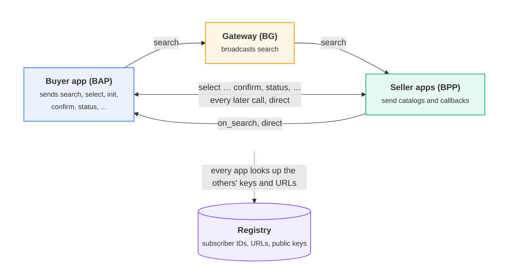

# How ONDC Works

An ONDC transaction moves through three broad stages. The Gateway takes part only in the first one; everything after that is direct between the buyer app (BAP) and the seller app (BPP).

**Discovery.** The buyer app sends a `search`. The Gateway broadcasts it to the relevant seller apps. Each seller app replies with its catalog via `on_search`, sent directly back to the buyer app.

**Order.** The buyer app and seller app now talk directly. The buyer app sends `select`, `init` and `confirm` to build and place the order, and the seller app responds to each and confirms the order.

**Fulfillment.** Once the order is placed, the seller app sends fulfillment updates and status callbacks (for example `on_status`) directly to the buyer app, which can also poll with `status`.

---

## How the participants connect

> **Colour key**, the same in every diagram of this guide: **blue** = buyer app (BAP), **green** = seller app (BPP), **amber** = Gateway, **violet** = Registry.

The Gateway is used only for `search`. Every other call goes directly between the buyer app and the seller app, and every app checks the Registry to find the other's URL and verify its signature.

---

## Where to Go Next

| To Learn About | See |
| --- | --- |
| How a complete transaction works, the protocol architecture, subscription and signing | [Protocol](/developer-guide/docs/protocol) |
| Every API, the `context` object and payload structure | [API Reference](/developer-guide/docs/api-reference) |
| Creating and verifying the `Authorization` header | [Signing & Verification](/developer-guide/auth-tools) |
| Signing and encryption keys | [Keys & Encryption](/developer-guide/docs/keys-and-encryption) |
| The Registry, lookup and the Gateway | [Registry & Gateway](/developer-guide/docs/registry-gateway) |
| Pushing transaction logs to ONDC | [Network Observability](/developer-guide/docs/network-observability) |
| City codes for `context.city` | [City & State Codes](/developer-guide/docs/city-state-codes) |
| `NACK` error codes | [Core Error Codes](/developer-guide/docs/error-codes) |
| Flows, payloads and rules of a specific domain | **Explore by Domain** |
