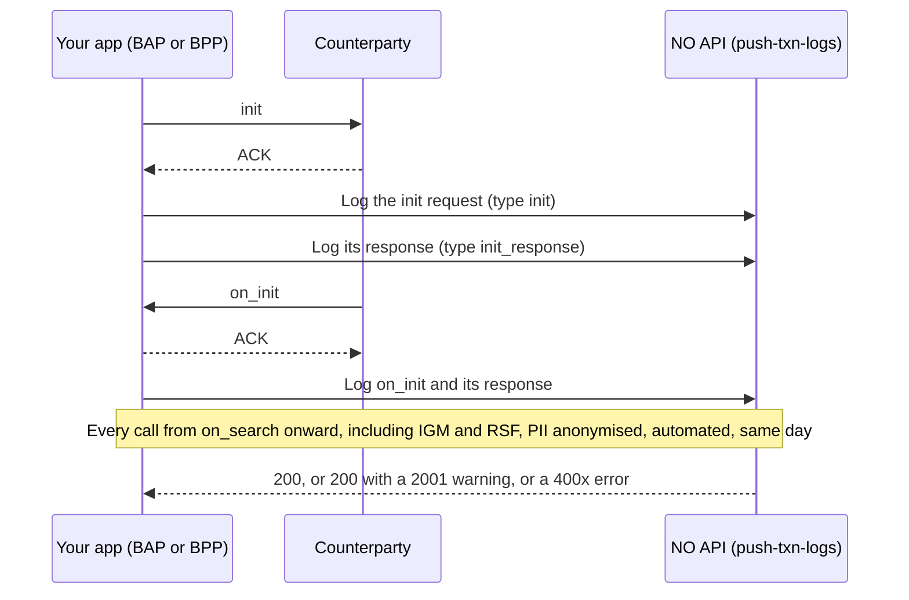

# Network Observability

Network Observability (NO) is the ONDC framework for observing the **business and technical health** of the network and surfacing actionable insights. Its goal is to improve interoperability, transparency, and trust among participants by giving the ecosystem the data it needs to self-correct and scale.

For you as a Network Participant (NP), NO is an **outbound obligation**: once you are live in Production, you push your transaction logs to the NO API automatically. You do not build the service — ONDC operates it — you feed it.

---

## The Bearer Token

NO authenticates log pushes with a **bearer token**. The token is an identifier tied to a **subscriber ID** and the **NP type**, and it is **domain-agnostic**.

- An NP with two subscriber IDs — one Buyer, one Seller — has **two** tokens.
- An NP with three subscriber IDs has **three** tokens.

Once you are subscribed to the **Production Registry**, you generate the token from the **NP Portal** under **Configuration Settings**. The token is valid for the **Production** stage only.

---

## What to Push, and When

You share the transaction JSON — **both request and response payloads** — for every API call from **`on_search` onward**: `on_search`, `select`, `on_select`, `init`, `on_init`, and so on. This includes:

- **IGM APIs** from `issue` onward (`issue`, `on_issue`, `issue_status`, `on_issue_status`).
- **RSF APIs** (`recon`, `on_recon`, `settle`, `on_settle`, `report`, `on_report`) and their synchronous responses.
- **ACKs and NACKs** for every request and response.
- **Unsolicited calls** you receive or respond to.

Each logged item carries a `type` (the API action name, with `_response` appended for the synchronous ACK/NACK) and a `data` object holding the actual payload.

### PII and anonymisation

- Buyer and Seller apps must **anonymise the PII** in each API payload.
- **City and Pincode must NOT be anonymised** — they are needed for network analysis.

### It must be automated

> Pushing logs must be an **automated process** from the NP's end — not a manual submission through Postman. Logs should reach NO the **same day**.

---

## Endpoint

| Property | Value |
|----------|-------|
| **Base URL** | `https://analytics-api.aws.ondc.org` |
| **Endpoint** | `https://analytics-api.aws.ondc.org/v1/api/push-txn-logs` |

A successful push returns `200` (optionally with a `2001` warning); contract or validation problems return a `400x` error.

---

## Compliance

NO requirements are **policy-mandatory**. Pushing your logs is not optional — it is required to stay compliant with the ONDC Network Observability notification. Treat the log push as part of going and staying live in Production, on the same footing as Registry subscription and signing.
