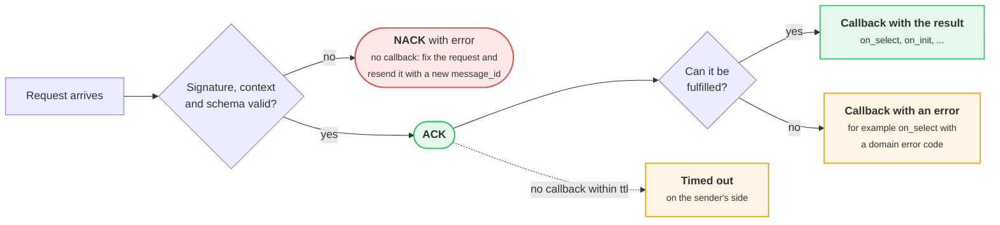
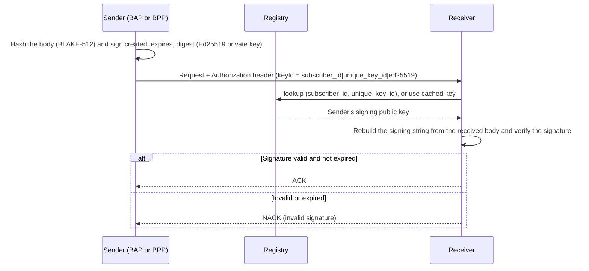

# ACK / NACK

Every ONDC request gets an **immediate, synchronous HTTP response** before any result is computed. That response is one of two acknowledgements:

- **`ACK`** — the request was accepted. The receiver will do the work and send the result later as an asynchronous `on_action` callback.
- **`NACK`** — the request was rejected outright. There is **no** callback; the error is returned with the `NACK` itself.

The `ACK`/`NACK` only says whether the request was accepted for processing. The actual outcome arrives later in the callback, which may itself carry an error. (For how the request/callback sequence works, see **API Calls**.)

## When something goes wrong

| Situation | What happens |
| --- | --- |
| The request is invalid (bad signature, wrong `context`, schema error) | The receiver answers `NACK` with an `error`. There is **no** callback; the sender must fix the request and send it again with a new `message_id`. |
| The request is valid, but cannot be fulfilled (for example, an item is out of stock) | The receiver answers `ACK`, then sends the callback with an `error` (for example `on_select` with a domain error code). |
| No callback arrives within the request's `ttl` | The sender treats the request as timed out. |

There are therefore **two places an error can surface**: synchronously on the `NACK` (the request was never accepted), or asynchronously on the callback (the request was accepted but could not be fulfilled). A timeout is neither — it is inferred by the sender when no callback arrives within the request's `ttl`.

See [Core Error Codes](/developer-guide/docs/error-codes) for the error codes carried in both places.

## Signature check: the first gate to ACK or NACK

Because every request and callback is signed, the receiver's **first** step is to verify the sender's signature. Due to the commercial nature of the transactions, every request/callback pair is considered a "contract" between two parties, so all requests and callbacks are digitally signed by the sender and verified by the receiver. A valid signature leads to `ACK`; an invalid or expired one leads to `NACK`.

Use the [Signing & Verification](/developer-guide/auth-tools) tab to create and verify headers, with the header format and reference code.
