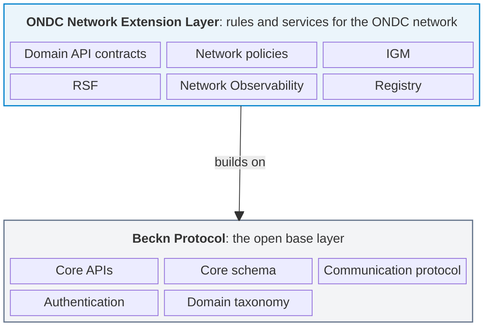
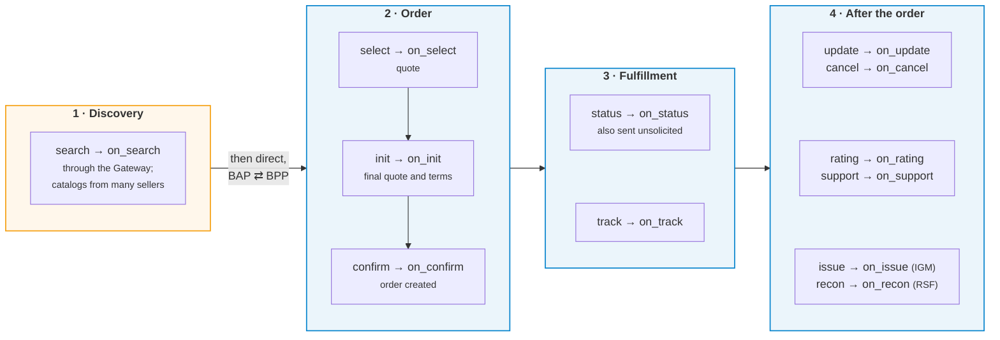
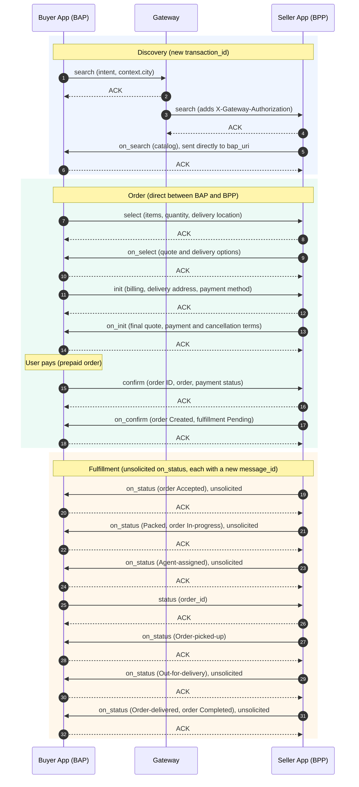
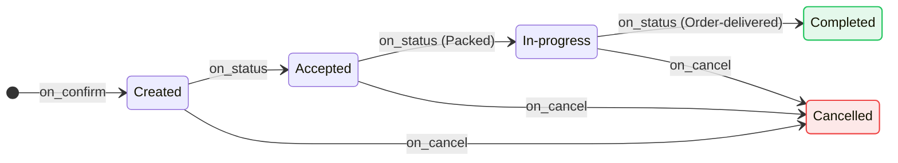
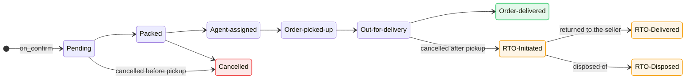

# API Calls

## The two-layer model

ONDC's protocol is structured as two distinct layers: an open base layer (Beckn) and an ONDC network extension on top of it.

**Beckn — the base layer.** [Beckn](https://becknprotocol.io/) is an open-source, domain-agnostic protocol for decentralized commerce. It defines the **Core APIs** (transaction APIs modeled after the order lifecycle — `search`, `select`, `init`, `confirm`, `status`, `track`, `update`, `cancel` — and their callbacks `on_search`, `on_select`, etc., plus supporting APIs like `rating` and `support`), the **Core Schema** (the data model: `Order`, `Item`, `Provider`, `Fulfillment`, `Payment`, `Billing`, …), the **Communication Protocol** (how APIs are called — async, server-to-server, ACK-based), **Authentication** (how participants sign and verify messages) and a **Domain Taxonomy** for industry-specific attributes. Beckn is transport-layer-agnostic; HTTP is the common implementation but not mandated.

**ONDC network extension — the upper layer.** ONDC adds domain-specific API contracts (retail, logistics, mobility, financial services, …), network policies, **IGM** (`issue`, `on_issue`, `issue_status`, `on_issue_status`), **RSF** (`recon`, `on_recon`, `settle`, `on_settle`), **Network Observability**, and Registry infrastructure for onboarding and key exchange.

See [API Reference](/developer-guide/docs/api-reference) for every API endpoint and its payload.

## The request–callback model

Every transaction on ONDC follows the same rules, whatever the domain:

- **Server-to-server:** the buyer app's backend (BAP) talks to the seller app's backend (BPP). The user's phone or browser never calls the network directly.
- **Asynchronous:** every request gets an immediate HTTP response, `ACK` (accepted) or `NACK` (rejected). The actual result comes later, as a separate request back to the sender, called a **callback**. Its name is the request's name with an `on_` prefix: `select` is answered by `on_select`.
- **Signed:** every request and callback carries an `Authorization` header signed by the sender. The receiver checks it against the sender's public key in the Registry before doing anything else.
- **Tracked:** every call carries a `context` with the same `transaction_id` for the whole transaction, and a `message_id` that links each request to its callback.
- **Logged:** both apps push every request and response to ONDC's [Network Observability](/developer-guide/docs/network-observability) service.

The immediate `ACK`/`NACK` is **synchronous**; the `on_action` callback is **asynchronous**. For what the acknowledgement means and when a `NACK` is returned, see **ACK / NACK**.

## The transaction at a glance

Every transaction moves through the same stages. Each box is a request and its callback.

## One order, start to finish

The walk-through below follows one Grocery order (`ONDC:RET10`), from search to delivery. Other domains use the same pattern, with their own steps and states; the use case's **API Walkthrough** under Explore by Domain shows the exact flow for each.

**Step 0 — Before the first call.** Both apps are registered in the ONDC Registry, with a subscriber ID, a subscriber URL and public keys. To call or verify another app, each one looks up the other's URL and public key in the Registry (and caches it).

**Step 1 — Search (BAP → Gateway → BPPs).** The user searches for "atta" in Bengaluru. The BAP creates a new `transaction_id` and a `message_id`, and sends `search` to the **Gateway** with `context.city: "std:080"` and the item, category or location in `message.intent`. The Gateway answers `ACK`, adds its own `X-Gateway-Authorization` signature, and forwards the `search` to every seller app registered for that domain and city. Each seller app checks both signatures and answers the Gateway with `ACK`.

**Step 2 — Catalogs (BPPs → BAP).** Each seller app with matching items sends `on_search` **directly to the BAP's** `bap_uri`, not through the Gateway. It carries the same `transaction_id` and `message_id`, its own `bpp_id` and `bpp_uri`, and its catalog in `message.catalog`. The BAP answers each one with `ACK` and shows the merged results to the user. From now on the BAP knows which seller app to talk to, and every call goes **directly** between the two apps.

**Step 3 — Select (BAP → BPP).** The user adds items to the cart. The BAP sends `select` to the chosen seller app's `bpp_uri`, with a **new** `message_id`, the provider, items and quantities, and the delivery location. The seller app answers `ACK`, then sends `on_select` with the same `message_id`: a **quote** with the price breakup (items, delivery, packing, taxes) and the delivery options available.

**Step 4 — Init (BAP → BPP).** The user checks out. The BAP sends `init` with the billing details, the delivery address and contact, and the payment method. The seller app answers with `on_init`: the final quote, the payment terms (who collects the payment, settlement details), and the cancellation terms.

**Step 5 — Payment.** For a prepaid order collected by the buyer app, the user now pays inside the BAP. For cash on delivery, nothing is paid yet.

**Step 6 — Confirm (BAP → BPP).** The BAP sends `confirm` with the order ID, the full order, and the payment status and transaction reference. The seller app answers with `on_confirm`: the order in state **`Created`**, with its fulfillment in state **`Pending`**. The order now exists on both sides.

**Step 7 — Fulfillment updates (BPP → BAP, unsolicited).** As the order moves, the seller app sends `on_status` **without being asked**, each time with a new `message_id` and the same `transaction_id`. First the seller accepts the order (order **`Accepted`**). Then the fulfillment moves through **`Packed`**, **`Agent-assigned`**, **`Order-picked-up`** and **`Out-for-delivery`** while the order is **`In-progress`**, and finally **`Order-delivered`**, when the order becomes **`Completed`**. See [Order and Fulfillment States](#order-and-fulfillment-states). At any time the BAP can also ask with `status` → `on_status`, or get live tracking with `track` → `on_track`.

**Step 8 — Changes after the order.** If the order changes, the same pattern applies:

- The buyer cancels: `cancel` → `on_cancel`, with a reason code; the seller app returns the cancelled order and any refund.
- The seller app cancels, for example when an item is out of stock: it sends `on_cancel` unsolicited.
- A return, a partial cancellation or a change of address: `update` → `on_update`, and the seller app may later send unsolicited `on_update` calls as the change progresses.

**Step 9 — After delivery.** The user can rate the order (`rating` → `on_rating`) or ask for support (`support` → `on_support`). If something went wrong, the BAP raises an issue (`issue` → `on_issue`) and follows it until it is resolved and closed; see Issue and Grievance Management in the [API Reference](/developer-guide/docs/api-reference).

**Step 10 — Settlement.** The app that collected the payment settles with the other according to the terms agreed in `on_init`. Where the Reconciliation and Settlement Framework applies, the apps reconcile with `recon` → `on_recon`.

## The whole flow

The diagram shows every call from `search` to the last `on_status` of one order, with the synchronous `ACK` for each. Solid arrows are requests and callbacks; dashed arrows are the `ACK` responses.

- Every request and callback is signed with an `Authorization` header and carries the same `transaction_id`.
- A request and its callback share a `message_id` (for example `status` and the `on_status` that answers it). Each unsolicited `on_status` has a new one. See **Message & Transaction ID**.
- The Gateway takes part only in `search`. Every call after `on_search` goes directly between the two apps.
- The other post-order calls (`track`, `update`, `cancel`, `rating`, `support`, `issue`) follow the same request, `ACK`, callback pattern.

## Order and Fulfillment States

An order has two states that move together: the **order** state (`order.state`) and the state of each **fulfillment** (`fulfillments[].state.descriptor.code`). The diagrams show them for a delivery order in Retail (`ONDC:RET10` 1.2.5); other domains use their own values, listed in each use case's API Walkthrough.

**Order state:**

**Fulfillment state** (delivery):

| Stage | Sent in | Order state | Fulfillment state |
| --- | --- | --- | --- |
| Order placed | `on_confirm` | `Created` | `Pending` |
| Seller accepts the order | `on_status` | `Accepted` | `Pending` |
| Packed, agent assigned, picked up, on the way | `on_status` | `In-progress` | `Packed` → `Agent-assigned` → `Order-picked-up` → `Out-for-delivery` |
| Delivered | `on_status` | `Completed` | `Order-delivered` |
| Cancelled | `on_cancel`, then `on_status` | `Cancelled` | `Cancelled`; after pickup, `RTO-Initiated` → `RTO-Delivered` or `RTO-Disposed` (return to origin) |

For every API endpoint and its payload, see [API Reference](/developer-guide/docs/api-reference). For what happens when a call cannot be accepted or fulfilled, see **ACK / NACK**.
