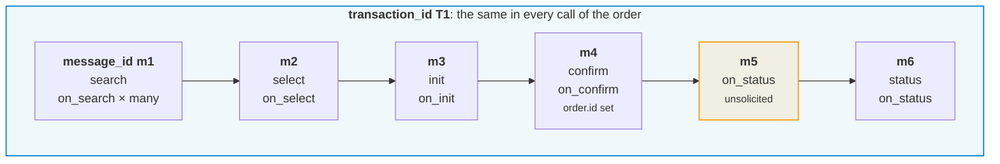

# Message & Transaction ID

Every ONDC call is **tracked** by two identifiers in its `context`:

- A **`transaction_id`** that is the same for the whole transaction, so both apps can group every call of one order together.
- A **`message_id`** that links each request to the callback that answers it.

A request and its callback share one `message_id`; an unsolicited callback gets its own. `bpp_id` and `bpp_uri` are known from `on_search` onwards.

### How the identifiers flow through a transaction

### The identifiers at a glance

| Identifier | Created by | Stays the same |
| --- | --- | --- |
| `transaction_id` | BAP, on `search` | In every call of the transaction, from `search` to the last post-order call. |
| `message_id` | The sender of each request | Between a request and its callback (`select` and `on_select`). Each unsolicited `on_status`, `on_update` or `on_cancel` has a new one. |
| `bpp_id`, `bpp_uri` | BPP, in `on_search` | In every call with that seller app after `on_search`. |
| Order ID | Set in `confirm` | In every post-order call, as `order.id` or `order_id`. |

### Why it matters

- Because the `transaction_id` never changes, logs, issues and settlements for one order can all be correlated, whichever app produced them.
- Because a request and its callback share a `message_id`, the sender can match an asynchronous callback back to the exact request it answers, even when many are in flight.
- Because each **unsolicited** callback (such as a seller-initiated `on_status`) carries a fresh `message_id`, it is clearly distinguished from a callback that answers a specific request.

For where these identifiers sit in the message envelope, see **Context**. For the request-and-callback call sequence they thread through, see **API Calls**.
