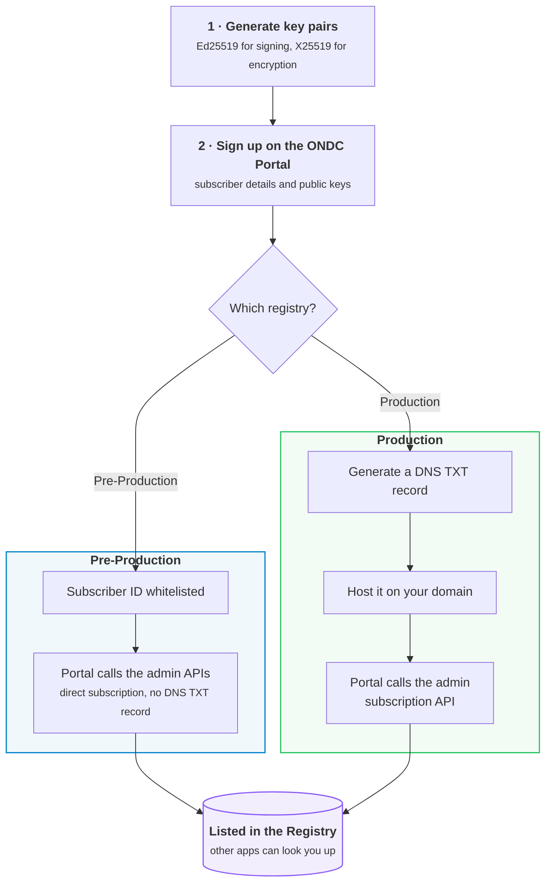

# Subscription

Before a Network Participant (NP) can transact, it must be **added to the ONDC Registry** — the central trust repository that stores each participant's metadata, public keys, subscriber ID and callback URL. Subscription is how an NP registers those details so other apps can look it up and verify its signatures.

## Start your ONDC journey

Sign up or sign in on the [ONDC Portal](https://portal.ondc.org) to register as a Network Participant and begin your ONDC journey.

## Subscription process

To enroll in the ONDC network, Network Participants must be added to the registry. The steps for an NP to onboard onto the ONDC Registry (Pre-Production, Production) are outlined as follows.

### 1. Pre-Production Registry
- Obtain whitelisting for the subscriber ID.
- The NP Portal invokes the admin subscription APIs.
- Keys are not validated upfront.
- Direct subscription is allowed.
- A DNS TXT record is **not** required.

### 2. Production Registry
Participants will have to:
1. Generate a DNS TXT record.
2. Host the DNS record on their domain.
3. The Portal calls the admin subscription API.

> **Note:** The steps involving a DNS TXT record apply only to the Production environment. Pre-Production supports direct subscription without DNS validation.

## Keys and encryption

Subscription begins with the NP generating **two key pairs**:

- An **Ed25519** key pair for **signing** requests and callbacks. The public signing key is published to the Registry so receivers can verify the NP's signatures (see **ACK / NACK**).
- An **X25519** key pair for **encryption**. The public encryption key is registered alongside, and is used for secure key exchange with the Registry during onboarding.

The NP submits its subscriber details and both public keys through the Portal. In **Production**, the NP additionally proves ownership of its domain by generating and hosting a **DNS TXT record** before the Portal calls the admin subscription API; in **Pre-Production**, keys are not validated upfront and direct subscription is allowed without a DNS TXT record. Once the admin subscription API completes, the NP is listed in the Registry and other apps can look it up.

## Terminology

| Term | Definition |
| ---- | ---------- |
| **Network Participant (NP)** | Any registered entity (buyer application, seller application, or gateway) on the ONDC network. |
| **Registry** | Central trust repository storing participant metadata, public keys, subscriber IDs, and callback URLs. |
| **Pre-Production Registry** | Testing and staging registry environment allowing direct subscription without DNS ownership validation. |
| **Production Registry** | Live registry environment that requires DNS TXT record verification and portal administration to enroll participants. |
| **Subscriber ID** | Unique FQDN-based identifier assigned to an NP to identify its transactions on the network. |
| **Subscriber** | A registered network participant authorized to transact on the ONDC network using verified keys and endpoints. |
| **DNS TXT Record** | Domain Name System text record hosted on the participant's domain to verify ownership during production onboarding. |
| **Signing and Verification** | Cryptographic authentication where HTTP requests and callbacks are digitally signed by the sender and validated by the receiver. |
