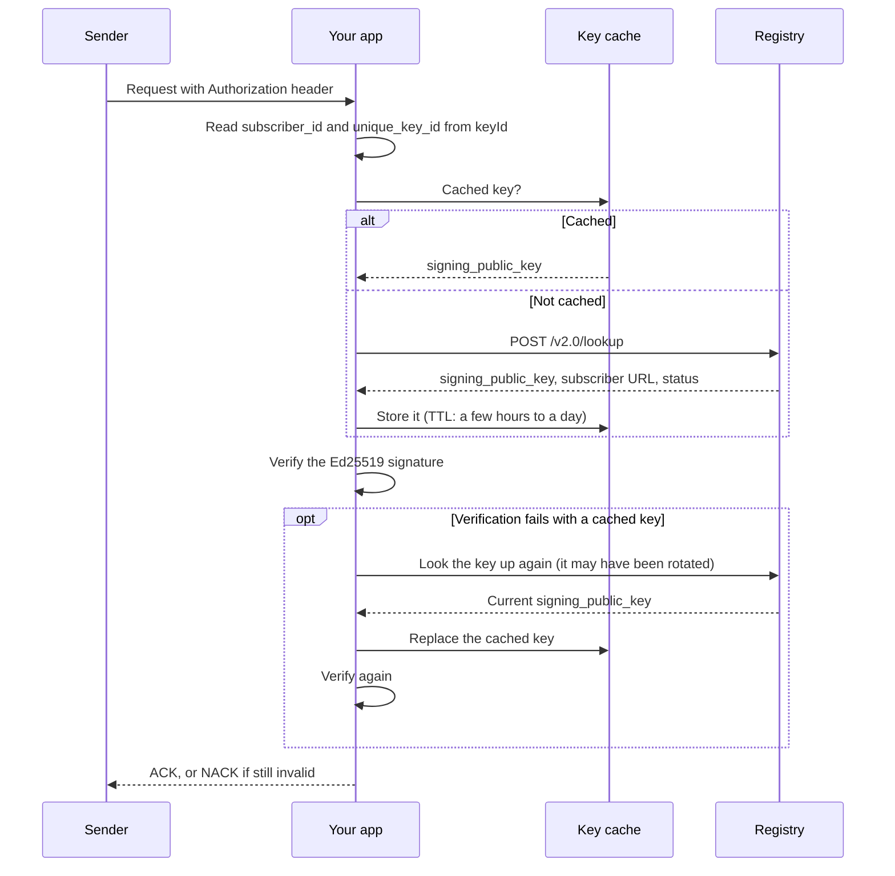

# Registry

The Registry is ONDC's **trust and identity infrastructure**. You never build or operate it — ONDC does — but your application talks to it constantly, so understanding what it stores and when your code calls it is essential.

Think of the Registry as **DNS plus a public-key directory combined**: a centralized lookup service that holds the identity, public keys, and endpoint metadata for every registered Network Participant (NP) on the network. It is the phonebook you look other NPs up in, and the phonebook other NPs look you up in.

---

## What the Registry Stores

Each NP has a subscriber record. The fields that matter to you as a developer:

| Field | What it means to you |
| -------------------- | -------------------------------------------------------------------------------------------- |
| `subscriber_id` | The NP's unique identifier (FQDN-based, e.g. `seller-app.com`) |
| `subscriber_url` | The base URL where this NP receives protocol callbacks |
| `signing_public_key` | Ed25519 public key — you use this to **verify** signatures on incoming requests from this NP |
| `encr_public_key` | X25519 encryption public key — registered alongside your signing key on the ONDC Portal |
| `unique_key_id` | Key identifier (an NP can have multiple keys, which supports rotation) |
| `type` | Role — `BAP`, `BPP`, or `BG` |
| `domain` | Domains this NP operates in (e.g. `ONDC:RET10`, `ONDC:TRV11`) |
| `status` | Registration status (`SUBSCRIBED`, `INITIATED`, etc.) |
| `city` | City codes this NP serves |

---

## When Your Code Talks to the Registry

### 1. Registration (on the ONDC Portal)

Registering your subscriber details and public keys is done on the [ONDC Portal](https://portal.ondc.org). Your server does **not** need to call `/subscribe` or implement `/on_subscribe` — the Portal handles onboarding.

### 2. On every incoming request — signature verification

When you receive an API call (say a BAP sends you `/init`), you must verify the sender's signature. To do that you need their `signing_public_key`, which you fetch from the Registry via `/lookup` (or `/vlookup` for a verified, signed participant record).



### 3. On outgoing requests — resolving the counterparty

When you need a counterparty's callback URL, or need to confirm they are a valid NP, you look them up in the Registry.

---

## Lookup Endpoint

| Environment | `/v2.0/lookup` |
| -------------- | --------------------------------------- |
| **Pre-Prod** | `preprod.registry.ondc.org/v2.0/lookup` |
| **Production** | `prod.registry.ondc.org/v2.0/lookup` |

**Request example:**

```bash
curl -X POST https://prod.registry.ondc.org/v2.0/lookup \
  -H "Content-Type: application/json" \
  -H "Authorization: Signature keyId=\"your-app.com|key123|ed25519\", ..." \
  -d '{
    "subscriber_id": "seller-app.com",
    "domain": "ONDC:RET10",
    "type": "BPP",
    "country": "IND"
  }'
```

---

## Caching Keys

You do not want to hit the Registry on every single incoming request. In practice:

- Cache public keys locally, keyed by `subscriber_id` + `unique_key_id`.
- Set a reasonable TTL (commonly a few hours to a day).
- Invalidate and re-fetch on a signature-verification failure — the NP may have rotated keys.

---

## Common Pitfalls

- **Forgetting to cache keys** — hitting `/lookup` on every request adds latency and can get you rate-limited.
- **Not handling key rotation** — if verification fails, re-fetch the key before returning a NACK. The NP may have rotated keys.
- **Mixing environment credentials** — Pre-Prod keys and tokens do not work in Prod. Each environment is completely isolated.
- **Pre-Prod URL path difference** — Pre-Prod uses `/ondc/lookup` while Prod uses `/lookup`. This catches people during environment migration.
